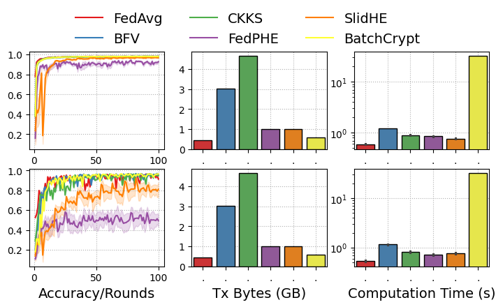
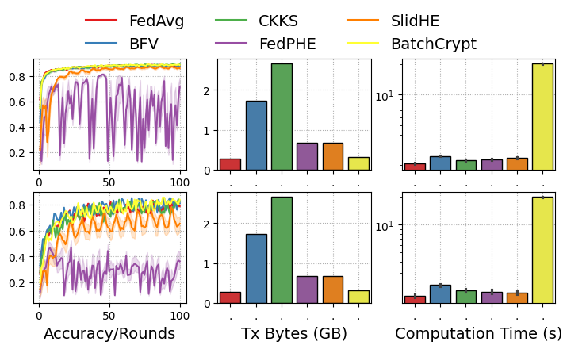

# Slidhe: Efficient Federated Learning with Homomorphic Encryption

This repository contains the code for **Slidhe**, an efficient solution for cross-silo Federated Learning (FL) using Homomorphic Encryption (HE). The approach combines packing, sparsification, and sliding window techniques to reduce computational and communication overheads, ensuring data privacy without compromising model performance.

## 🚀 Features

- **Secure Federated Learning**: Uses Homomorphic Encryption (HE) to preserve data privacy.
- **Overhead Reduction**: Implements packing and sparsification techniques to optimize communication and processing.
- **Robust to Non-IID Data**: Maintains performance even in heterogeneous data scenarios.
  
## ✨ Key Contributions

- **Privacy-Preserving Learning**: Utilizes CKKS-based Homomorphic Encryption to secure model updates.
- **Low Overhead**: Reduces ciphertext generation and transmission through packing and selective encryption.
- **Three Packet Selection Strategies Implemented**:
  - **Top-k**: Selects the top-k% packets with the largest weight sums.
  - **Round Robin (RR)**: Sequentially cycles through packets, ensuring all model neurons are trained.
  - **Sliding Window (SW)**: Selects overlapping packet windows to promote neuron sharing across rounds.


---

## 📋 Requirements

- **Docker** and **Docker Compose** for containerized setup.
- **Python 3.8+** with the following libraries:
  - `tensorflow`
  - `flower`
  - `tenseal`
  - `numpy`
  - `matplotlib`
  - `gmpy2`

---

## ⚙️ Usage

### 1. Clone the repository
```bash
$ git clone https://github.com/YourUsername/slidhe.git
$ cd slidhe
```

### 2. Build Docker images
Use Docker to set up server and client environments.
```bash
$ docker build -t flhe:server server/.
$ docker build -t flhe:client client/.
```

### 3. Generate Docker Compose file
Alternatively, install the dependencies manually and run locally:
```bash
$ python3 create_dockercompose.py -c 10 -s FedPHE -d MNIST -r 100 -f 0.5 --niid True --dirichilet 0.1 --percentage 0.3 --technique robin_round
# -c : Number of clients
# -s : Solution [BFV, CKKS, BatchCrypt, FedPHE, plaintext]
# -d : Dataset [Mnist, FashionMnist]
# -r : Number of communication rounds
# -f : Aggregated clients fraction [0,...,1]
# --niid : IID or Non-IID scenario [True, False]
# --dirichilet: Dirichlet factor [0,...,1]
# --percentage: Percentage of selected packets for aggregation [0,...,1]
# --technique: Packet selection technique [topk, robin_round, slided_window, weight_random]
```

---

## 4. Generate encryption keys
```bash
$ python3 generate_keys.py
```

## 5. Run
```
$ docker compose -f your_generated_file.yaml up
```

## 🔁 Reproducing Results

To reproduce the main experiment (Non-IID, α=0.1, 30% packets, Round Robin):

```
python3 create_dockercompose.py -c 10 -s FedPHE -d MNIST -r 100 -f 0.5 --niid True --dirichilet 0.1 --percentage 0.3 --technique round_robin
```

To explore other strategies:

- **Top-k**: `--technique topk`
- **Sliding Window (50% overlap)**: `--technique slided_window`

---

## 📂 Repository Structure

```
├── client/
│   ├── client.py         # FL client logic
│   ├── literature.py     # Implementations from literature
│   ├── models.py         # ML model definitions
│   ├── client_utils.py   # Client-side utilities
│   ├── encryption/
│   │   ├── bfv.py        # BFV scheme implementation
│   │   ├── ckks.py       # CKKS scheme implementation
│   │   └── paillier.py   # Paillier scheme implementation
├── server/
│   ├── server.py         # FL server logic
│   ├── server_utils.py   # Server-side utilities
├── logs/                 # Execution results
├── docker-compose.yml    # Docker config
├── requirements.txt      # Project dependencies
└── README.md             # Project documentation
```

---

## 📊 Experimental Results

The experiments used MNIST and FashionMNIST datasets. A DNN with layers of 128, 64, and 32 neurons was used for MNIST, while LeNet-5 was used for FashionMNIST. Training was done using Stochastic Gradient Descent (SGD) and Sparse Categorical Crossentropy loss. HE schemes tested included CKKS, BFV, BatchCrypt, FedPHE, and Slidhe. A total of 10 clients were used, with 50% selected per round across 100 communication rounds. Data heterogeneity was controlled via Dirichlet distribution with α = 1 for IID and α = 0.1 for Non-IID.

| **Data**   | **Solution**  | **Accuracy (%)** | **TX Bytes (Mb)** | **Time (s)** | **Accuracy (%)** | **TX Bytes (Mb)** | **Time (s)** |
|-----------|---------------|------------------|-------------------|--------------|------------------|-------------------|--------------|
|           |               | **MNIST**        |                   |              | **FashionMNIST** |                   |              |
| **IID**   | FedAvg        | 0.97             | 449.49            | 0.59         | 0.90             | 272.25            | 2.06         |
|           | BFV           | 0.97             | 3009.08           | 1.21         | 0.90             | 1719.48           | 2.46         |
|           | CKKS          | 0.97             | 4651.85           | 0.89         | 0.90             | 2658.22           | 2.22         |
|           | BatchCrypt    | 0.97             | 571.77            | 32.14        | 0.88             | 317.68            | 20.35        |
|           | FedPHE        | 0.94             | 996.94            | 0.72         | 0.81             | 664.63            | 2.26         |
|           | Slidhe        | 0.96             | 996.95            | 0.76         | 0.85             | 664.63            | 2.36         |
| **Non-IID**| FedAvg       | 0.97             | 449.49            | 0.53         | 0.84             | 272.25            | 1.69         |
|           | BFV           | 0.95             | 3009.08           | 1.15         | 0.79             | 1719.48           | 2.21         |
|           | CKKS          | 0.95             | 4651.85           | 0.82         | 0.81             | 2658.22           | 1.94         |
|           | BatchCrypt    | 0.95             | 571.77            | 31.96        | 0.83             | 317.68            | 19.99        |
|           | FedPHE        | 0.49             | 996.94            | 0.71         | 0.35             | 664.63            | 2.26         |
|           | Slidhe        | 0.92             | 996.95            | 0.77         | 0.75             | 664.63            | 2.36         |


The graphs below depict the performance on IID (top) and Non-IID (bottom) datasets.

### Mnist Dataset


### Fashion Dataset


---

## 📜 References

This work is based on the article:

**"Exploring Communication Efficient Methods for Homomorphic Encryption Federated Learning"**  
Yuri Dimitre D. Faria, Allan M. de Souza  
Institute of Computing - University of Campinas

---

## 🤝 Acknowledgements

Special thanks to the following projects and contributors for their foundational research and code:

- [FedPHE](https://github.com/lunan0320/FedPHE) – for the paper "Efficient and Straggler-Resistant Homomorphic Encryption for Heterogeneous Federated Learning".
- [BatchCrypt](https://github.com/marcoszh/BatchCrypt) – for the paper "BatchCrypt: Efficient Homomorphic Encryption for Cross-Silo Federated Learning".
- [FLASHE](https://github.com/SamuelGong/FLASHE) – for their packet sparsification optimization techniques.

---

## 📄 License

This project is licensed under the MIT License. See the `LICENSE` file for details.
