# Slidhe / NVNL: Aprendizado Federado com Criptografia Homomórfica e Esparsificação por Pacotes

Este repositório implementa e avalia **Aprendizado Federado (FL) com Criptografia Homomórfica (HE)**. Cada cliente treina um modelo local, cifra (parte de) seus pesos e os envia a um servidor, que agrega **sem decifrar**. Para reduzir o custo da HE, os pesos são divididos em **pacotes (packs)** do tamanho de um ciphertext CKKS, e só uma fração deles é cifrada e transmitida a cada rodada.

O foco da pesquisa (jun.–ago./2026) é medir o impacto da esparsificação **NVNL (round-robin)** na comunicação, no tempo e na acurácia, comparada com três outras estratégias de seleção de pacotes:
- **FedPHE** (top-k)
- **SW** (janela deslizante)
- **RW** (aleatório ponderado)

As técnicas também são comparadas com baselines de HE que cifram o modelo inteiro (CKKS, BFV, BatchCrypt/Paillier) e com o FedAvg em texto claro.

> **Leia antes de interpretar qualquer resultado:** nos experimentos rodados antes de 2026-08-11, o rótulo `niid0.1` das pastas corresponde a uma partição **IID**. Detalhes na seção [Limitações e problemas conhecidos](#15-limitações-e-problemas-conhecidos).

---

## Sumário

1. [Visão geral da arquitetura](#1-visão-geral-da-arquitetura)
2. [Empacotamento (packing) e agregação por pacote](#2-empacotamento-packing-e-agregação-por-pacote)
3. [Técnicas implementadas](#3-técnicas-implementadas)
4. [Criptografia e backends CKKS](#4-criptografia-e-backends-ckks)
5. [Modelos, datasets e particionamento](#5-modelos-datasets-e-particionamento)
6. [Estrutura do repositório](#6-estrutura-do-repositório)
7. [Como rodar](#7-como-rodar)
8. [Experimentos propostos](#8-experimentos-propostos)
9. [Estrutura dos outputs (`logs/`)](#9-estrutura-dos-outputs-logs)
10. [Checkpoint e resume](#10-checkpoint-e-resume)
11. [Suíte de análise (`studies/`)](#11-suíte-de-análise-studies)
12. [Resultados](#12-resultados)
13. [Testes](#13-testes)
14. [Documentação auxiliar](#14-documentação-auxiliar)
15. [Limitações e problemas conhecidos](#15-limitações-e-problemas-conhecidos)
16. [Referências, agradecimentos e licença](#16-referências-agradecimentos-e-licença)

---

## 1. Visão geral da arquitetura

**Pilha:**
- **Flower 1.4** (`flwr==1.4.0`) e **TensorFlow 2.13**, rodando em containers (`flhe:server` e `flhe:client`, Docker ou Singularity).
- **Servidor** (`server/server.py`, `HEServer`): estende `fl.server.strategy.FedAvg`.
- **Clientes** (`client/client.py`, `HEClient`): estendem `fl.client.NumPyClient`.
- **Configuração:** toda feita por variáveis de ambiente (`SOLUTION`, `PERCENTAGE`, `NIID`, `MODEL_ARCH`, `CKKS_BACKEND`, …) passadas por `run_server.sh` e `run_client.sh`.

Uma rodada de uma técnica com packing:

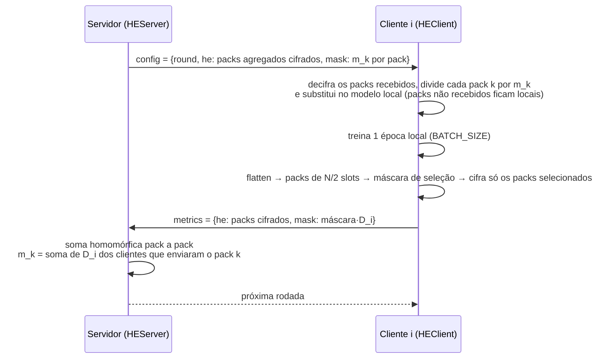

- **Seleção de clientes:** o servidor espera `NCLIENTS` conectados. Por rodada, sorteia `round(NCLIENTS·CLIENT_FRACTION)` para treino e o mesmo número para avaliação, em sorteios independentes (`server/server.py:87-95`).
- **Avaliação:** acurácia global = média simples das acurácias dos clientes; loss = média ponderada pelo número de exemplos (`server/server.py:260-264`).

---

## 2. Empacotamento (packing) e agregação por pacote

O mecanismo é comum a todas as técnicas com esparsificação (`fedphe`, `nvnl`, `sw` e `rw`).

1. **Flatten.** `flat_parameters(model.get_weights())` concatena todos os tensores do modelo, incluindo média e variância móveis de BatchNorm (`client/models.py:279`). O estado do otimizador (Adam) nunca é compartilhado.
2. **Divisão em packs.** `packing()` (`client/client_utils.py:15`) fatia o vetor em blocos consecutivos de `N/2` valores (4096 para `N = 8192`). São `n_packs = n_params // 4096 + 1` packs, e o último é mais curto (não há padding).
3. **Máscara.** A técnica escolhe `k = ceil(n_packs · PERCENTAGE)` packs (ver [seção 3](#3-técnicas-implementadas)).
4. **Cifragem.** `cypher_packs()` cifra e serializa **só** os packs com `mask[k] = 1`. A máscara vai junto, sem cifra.
5. **Agregação no servidor** (`server/server_utils.py:86`, `aggregate_packs_and_mask`). Cada ciphertext é colocado na posição do seu pack, e os packs de mesmo índice são somados homomorficamente. Para cada pack k, o servidor calcula também a massa de contribuição
   `m_k = Σ_{i ∈ S_k} D_i`, em que `S_k` é o conjunto de clientes que enviaram o pack k e `D_i` é o número de exemplos do cliente i.
6. **Reconstrução no cliente** (`client/literature/set_parameters.py:99`, `he_packs_to_model`). O cliente decifra cada pack agregado, divide por `m_k` e **substitui** o pack correspondente no seu modelo. Com isso, cada pack recebido vira a média FedAvg **só entre os clientes que o enviaram**:

   ```
   w_k = Σ_{i ∈ S_k} D_i · w_i,k  /  Σ_{i ∈ S_k} D_i
   ```

   Packs que ninguém enviou continuam com o valor local do próprio cliente. Por isso, clientes diferentes podem ter modelos diferentes fora dos packs agregados.

Como a ponderação é feita depende do backend:

| Backend | Cliente | Servidor | `m_k` |
|---|---|---|---|
| `tenseal` | envia `w` | multiplica o ciphertext por `D_i/D_round` e soma | `Σ_{S_k} D_i / D_round` |
| `ckks_python_simplify` com `MAGG_RENORM=1` (padrão) | envia `w · D_i` | soma pura (o backend não faz multiplicação por escalar fracionário) | `Σ_{S_k} D_i` |
| `ckks_python_simplify` com `MAGG_RENORM=0` (legado) | envia `w / NCLIENTS` | soma pura | o cliente **não** divide por `m_k`, o que enviesa o FedPHE e o RW |

`MAGG_RENORM` foi introduzido depois da auditoria em `DIVISOR_AUDIT.md`. O teste A/B dele está em `experiments/tests/test_magg_ab.sh`.

---

## 3. Técnicas implementadas

A variável `SOLUTION` define o caminho completo de cifra e agregação. Cliente e servidor chamam `config_solution()` (`client/client.py:223`, `server/server.py:98`):

| `SOLUTION` | Família | HE | Packing | `only_sum` | Esquema | Função de treino |
|---|---|---|---|---|---|---|
| `plaintext` | baseline | não | não | — | — | `fit_plaintext` |
| `ckks` | modelo inteiro | sim | não | não | CKKS | `fit_ckks` |
| `bfv` | modelo inteiro | sim | não | sim | BFV | `fit_bfv` |
| `batchcrypt` | modelo inteiro | sim | não | sim | Paillier | `fit_batchcrypt` |
| `fedphe` | esparsificação | sim | sim | não | CKKS | `fit_fedphe` |
| `nvnl` | esparsificação | sim | sim | não | CKKS | `fit_nvnl` |
| `sw` | esparsificação | sim | sim | não | CKKS | `fit_sw` |
| `rw` | esparsificação | sim | sim | não | CKKS | `fit_rw` |

Cada `client/literature/<solução>.py` define uma função `fit_<solução>` que segue o mesmo roteiro: recebe o agregado, reconstrói o modelo, treina, seleciona, cifra e devolve a mensagem. Cada etapa é cronometrada (tempo de relógio e de CPU) e gravada em `train.csv`.

### 3.1 Baselines sem esparsificação

- **`plaintext` (FedAvg):** `client/literature/plaintext.py`. Carrega os pesos globais, treina e devolve os pesos. O servidor usa o `aggregate` do Flower, ponderado por número de exemplos (`server/server.py:234`). É a referência de acurácia.
- **`ckks`:** `client/literature/ckks.py`. O modelo inteiro vira um único `ts.ckks_vector` do TenSEAL, que divide internamente em vários ciphertexts. O servidor calcula `Σ ct · n_i/N`. A cada 5 rodadas também estima o erro σ do CKKS.
- **`bfv`:** `client/literature/bfv.py`. Multiplica por `D_i`, quantiza em 22 bits (clip em ±α, com arredondamento estocástico, `client/encryption/quantize.py`) e cifra com `ts.bfv_vector`. O servidor faz soma pura. O cliente desquantiza e divide pelo total de exemplos.
- **`batchcrypt`:** `client/literature/batchcrypt.py`, reimplementação do BatchCrypt. Multiplica por `D_i`, quantiza em 32 bits com complemento de dois, empacota **50 valores por plaintext Paillier** (chave de 2048 bits) e cifra. O servidor agrega pelo produto de ciphertexts módulo n².

### 3.2 Estratégias de seleção de pacotes

As máscaras ficam em `client/literature/fedphe.py:121-199`. `NVNL.py`, `sw.py` e `rw.py` têm cópias locais das funções que usam. Notação: `n` = número de packs, `p` = `PERCENTAGE`, `k = ceil(n·p)`, `r` = rodada global (começa em 1).

| Técnica | Função | Regra de seleção |
|---|---|---|
| **FedPHE** (top-k) | `get_topk_mask` | Os k packs de maior **norma L2** dos pesos treinados (não da atualização). Depende dos dados; na prática, repete quase sempre os mesmos packs. |
| **NVNL** (round-robin) | `get_robin_round_mask` | Janela de k packs com passo k: packs `[r·k, r·k + k) mod n`. Não há sobreposição, e o modelo inteiro é coberto a cada `ceil(n/k)` rodadas. Todos os clientes enviam os mesmos packs na mesma rodada. |
| **SW** (sliding window) | `get_slide_window_mask(..., stride=0.5)` | Janela de k packs com passo `ceil(0.5·k)`. Janelas consecutivas se sobrepõem em cerca de metade, então a cobertura completa leva cerca de 2× mais rodadas que no NVNL. |
| **RW** (pondering random) | `get_pondering_random_mask` (`rw.py`) | Sorteio sem reposição de k packs, com probabilidade proporcional a um peso por pack. Pela intenção do código, o pack sorteado tem o peso multiplicado por 0,5 e os demais recebem +0,1. **Na prática o peso nunca muda e o sorteio é uniforme** (ver [seção 15](#15-limitações-e-problemas-conhecidos)). |

**Exemplo executado.** A grade abaixo saiu das funções do repositório com `n = 10` packs e `p = 0.3` (`k = 3`). `█` = pack enviado. Para o FedPHE, as normas dos packs foram fixadas em `[0.1, 0.9, 0.2, 0.8, 0.1, 0.3, 0.7, 0.1, 0.2, 0.4]`.

```
pack:        0 1 2 3 4 5 6 7 8 9
FedPHE  r1:  · █ · █ · · █ · · ·     sempre os 3 packs de maior norma
        r2:  · █ · █ · · █ · · ·
        r3:  · █ · █ · · █ · · ·
NVNL    r1:  · · · █ █ █ · · · ·     janela de 3, passo 3: sem sobreposição
        r2:  · · · · · · █ █ █ ·
        r3:  █ █ · · · · · · · █     (volta ao início: mod n)
        r4:  · · █ █ █ · · · · ·
SW      r1:  · · █ █ █ · · · · ·     janela de 3, passo ceil(3·0.5) = 2
        r2:  · · · · █ █ █ · · ·     o pack 4 repete
        r3:  · · · · · · █ █ █ ·     o pack 6 repete
RW      r1:  · · · █ · · · █ · █     sorteio uniforme (pesos continuam em 1.0)
        r2:  █ █ · · · █ · · · ·
```

**Rodadas até o servidor receber todos os packs pelo menos uma vez** (estudo 10, teórico):

| Técnica | Fórmula | ResNet-20 (n = 67), p = 0.1 | p = 0.5 |
|---|---|---|---|
| NVNL | `ceil(n / k)` | 10 | 2 |
| SW | `ceil(n / ceil(0.5·k))` | 17 | 4 |
| RW | ≈ `(n/k) · ln n` (colecionador de cupons) | ≈ 40 | ≈ 8 |
| FedPHE | — | nunca (top-k fixo) | nunca |

---

## 4. Criptografia e backends CKKS

`encryption/ckks_backend.py` define a ABC `CKKSBackend`, com os métodos `generate_and_save`, `load_client_context`, `load_server_context`, `encrypt`, `serialize`, `deserialize`, `add`, `mul` e `decrypt`. O backend é escolhido pela variável `CKKS_BACKEND`, e `get_backend(name)` funciona como factory.

| `CKKS_BACKEND` | Implementação | Arquivos em `context/` | Observações |
|---|---|---|---|
| `tenseal` | TenSEAL (Microsoft SEAL) | `tenseal_client.pkl`, `tenseal_server.pkl` | Multi-nível. Aceita multiplicação por escalar fracionário. Usado por `ckks`, `bfv` e `batchcrypt`. |
| `ckks_python_simplify` | `ckks_project/` (biblioteca C++ própria com bindings pybind11, pacote `ckks_federated`) | `ckks_simplify_params.pkl`, `ckks_simplify_{sk,pk}.bin` | Módulo q único, sem rescaling; `mul` só aceita inteiro ≥ 1. Parâmetros: `SIMPLIFY_N=8192`, `SIMPLIFY_BITS=62`, `SIMPLIFY_SCALE_BITS=40`, o que dá faixa de ±2²¹ por ciphertext (ver `CKKS_PARAMS.md`). **É o backend de todas as técnicas com packing nos experimentos atuais.** |

- **Cópias sincronizadas:** existem três cópias idênticas de `ckks_backend.py`, em `encryption/`, `client/encryption/` e `server/encryption/`. Cada container monta só o próprio diretório, então as três precisam ser mantidas em sincronia.
- **Geração de chaves:** `generate_keys.py` roda no **host**, então `ckks_project` também precisa estar instalado localmente (instruções em `CLAUDE.md`). Ele gera as chaves CKKS pelo backend, BFV (`N=8192`, `[50,50,50,50]`, `t=1073872897`) e Paillier (2048 bits). Os scripts de experimento chamam a geração antes de cada run.
- **Limitação conhecida: faixa do primo único.** Com `SIMPLIFY_BITS=62` e `SIMPLIFY_SCALE_BITS=40`, a decifragem só é correta enquanto cada **coeficiente do polinômio** da **soma do servidor** fica abaixo de q/(2Δ) ≈ 2²¹. Isso equivale a ~2²¹ na média de um pacote e a ~2²¹·N/2 para uma coordenada isolada. Sem pré-escala, o protocolo com peso por D_i (`MAGG_RENORM=1`) cifra `w·D_i`, e o servidor soma até `ΣD·w`. Em MobileNetV2/CIFAR-10 α=1 com p ≥ 0.7, o pacote com `Conv_1_bn/moving_variance` passou desse limite perto da rodada 104: cada peso do pacote errou em ±2²²/ΣD ≈ 84, a variância ficou negativa e a avaliação foi a NaN / 0,100. A correção é a pré-escala pública `MAGG_D_REF=1024` (`client/client_utils.py`): o cliente cifra `w·D_i/1024`. O FedAvg continua idêntico, o tamanho do ciphertext não muda e a folga aumenta 1024×, mas o limite continua existindo. Detalhes, evidência e custo das alternativas estão em `docs/ckks_range_overflow.md`. A razão real por rodada fica em `range.csv`.
- **Log de mudanças:** `ckks_change_logs/` guarda notas geradas automaticamente por um hook do Claude Code sempre que `ckks_backend.py` ou `ckks_project/` mudam.

---

## 5. Modelos, datasets e particionamento

Os modelos ficam em `client/models.py` (`create_<nome>(input_shape, num_classes)`), compilados com Adam (lr 1e-3, 3e-4 no ViT) e *sparse categorical cross-entropy*. O modelo é escolhido por `MODEL_ARCH` (nome da factory sem o prefixo `create_`). Parâmetros e packs abaixo foram medidos nos logs (`train.csv`, `N = 8192`, 4096 slots por pack):

| `MODEL_ARCH` | Dataset nos experimentos | Parâmetros | Packs | `BATCH_SIZE` |
|---|---|---|---|---|
| `dnn_tiny` | Fashion-MNIST | 111.146 | 28 | 4 |
| `lenet5` | Fashion-MNIST | 61.706 | 16 | 4 |
| `resnet20` | CIFAR-10 | 274.042 | 67 | 4 |
| `mobilenetv2` (α = 0.5, redimensiona para 96×96) | CIFAR-10 | 719.034 | 176 | 16 |
| `vit_tiny` (patch 4, dim. 64, profundidade 6) | GTSRB (`tanganke/gtsrb`, 32×32, 43 classes) | 210.987 | 52 | 16 |

Também existem `dnn`/`dnn_base` e `simple_cnn`, fora dos experimentos atuais.

**Particionamento** (`client/dataset_utils.py:157`, via `flwr-datasets`):
- **Treino não-IID:** `DirichletPartitioner(alpha=NIID, partition_by="label", min_partition_size=100, seed=SEED)`. O seed é o mesmo em todos os clientes, e cada cliente pega a própria fatia.
- **Treino IID:** `IidPartitioner`.
- **Teste:** sempre IID.

**Pesos iniciais:** ficam em `logs/models/init_weights/<modelo>/<dataset>/…/init_weights_<cid>.weights.h5`. Qualquer solução cria esses arquivos se estiverem ausentes, com seed fixo, para que todas as técnicas partam do mesmo modelo.

> ⚠️ **Rótulo `NIID` nas runs antigas.** Até o commit `7c5984b` (2026-08-11), o cliente fazia `niid = (NIID == 1)`. Por isso:
>
> | Família (data das runs) | pasta `niid0.1` | pasta `niid1` |
> |---|---|---|
> | `sparsification_percentage` (jun.–jul.), `client_frac` (jun.), `stress_test_client` (jul.) | **IID** (`distribution=iid` no `train.csv`) | Dirichlet α = 1.0 |
> | `seed_experiment` (ago., depois da correção) | Dirichlet α = 0.1 | Dirichlet α = 1.0 |
>
> A coluna `distribution` do `train.csv` é a fonte confiável. Neste README, a pasta `niid0.1` das famílias antigas é chamada de **IID** e a pasta `niid1` de **não-IID (α = 1)**.

---

## 6. Estrutura do repositório

```
keys/
├── client/                      # container do cliente (flhe:client)
│   ├── client.py                # HEClient: lê env vars, config_solution(), despacha fit_* e evaluate
│   ├── client_utils.py          # packing, cypher_packs, decypher_packs, flat_packs, remove_padding
│   ├── client_logs.py           # train.csv (46 colunas), evaluate.csv (17), mask.csv
│   ├── dataset_utils.py         # carregamento flwr-datasets + particionamento IID/Dirichlet
│   ├── models.py                # factories de modelos Keras
│   ├── literature/              # um fit_<solução> por técnica
│   │   ├── plaintext.py, ckks.py, bfv.py, batchcrypt.py      # baselines
│   │   ├── fedphe.py            # top-k + TODAS as funções de máscara
│   │   ├── NVNL.py, sw.py, rw.py                              # seleção de pacotes
│   │   └── set_parameters.py    # decifra e reconstrói o modelo; salva snapshots/checkpoints
│   ├── encryption/              # cópia de encryption/ para o container do cliente
│   ├── Dockerfile, singularity.def
├── server/                      # container do servidor (flhe:server)
│   ├── server.py                # HEServer(FedAvg): aggregate_fit, resume, parada por tempo limite
│   ├── server_utils.py          # align_packs, aggregate_packs_and_mask, agregação sem packing
│   ├── server_logs.py           # server_agg.csv, server_eval.csv, coverage.csv
│   ├── encryption/, Dockerfile, singularity.def
├── encryption/                  # cópia usada no host (generate_keys.py): ckks_backend, bfv, paillier, quantize*
├── ckks_project/                # biblioteca CKKS própria (C++17 + pybind11 + pacote ckks_federated)
├── context/                     # chaves HE geradas (ignoradas pelo git, exceto arquivos legados)
├── experiments/                 # scripts de experimentos temáticos (seção 8)
│   ├── lib.sh                   # escolhe o backend: lib_slurm.sh se $SLURM_JOB_ID, senão lib_tmux.sh
│   ├── lib_tmux.sh, lib_slurm.sh# run_theme(): varre pares × soluções × niid × % × seeds × frações
│   ├── sparsification_percentage/, client_frac/, seed_experiment/, stress_test_client/
│   ├── standalone/              # template.sh (modelo de tema), benchmark_resources.sh
│   ├── tests/                   # smoke tests end-to-end (Docker)
│   ├── check_status.py          # auditoria done/partial/missing/wrong backend
│   ├── estimate_time.py         # estimativa de tempo por partição SLURM (+ ESTIMATION_METHODOLOGY.md)
│   ├── generate_resume_jobs.py  # gera resume.sh/resume_sbatch.sh para runs interrompidas
│   └── merge_resume.py          # funde a run original com as retomadas
├── sbatch/                      # um job SLURM por script de experimento + submit_per_pair.sh
├── studies/                     # análise: gera figuras e tabelas, nunca roda experimentos (seção 11)
│   ├── general/                 # CÓDIGO: 01_*.py … 28_*.py, load_data.py, run_all.sh
│   ├── sparsification_percentage/, client_frac/   # SAÍDA: figures/, tables/
│   └── sparsification_percentage_old/             # geração antiga (maio–jun.), obsoleta
├── logs/                        # resultados brutos (seção 9)
├── dissertation/capitulo5/      # resultados.tex, FIGURAS.md, gerar_figuras_cap5.py, gerar_tabelas_fedphe.py
├── benchmark/                   # FedAvg standalone (sem HE) para escolher batch size: MobileNetV2/CIFAR-10, ViT/GTSRB
├── tests/                       # testes pytest + bash (seção 13)
├── docs/                        # documentação técnica (seção 14)
├── typings/                     # stubs de tipo (keras, tensorflow, tenseal)
│
├── run_server.sh, run_client.sh # sobem server.py / client.py em Docker ou Singularity (chamados por lib_*.sh)
├── generate_keys.py             # gera chaves CKKS/BFV/Paillier em context/
├── resume_all.sh                # gera e submete os jobs de resume
├── sync_remote.sh               # rsync do código para o cluster (exclui logs/)
├── fetch_logs_from_remote.sh    # rsync dos logs do cluster (pula *.npz, *.h5, *.log)
├── Makefile                     # configure, singularity-*, keys, test-ckks*, cleanlogs (rm -rf logs/!)
├── SLURM.md                     # partições do cluster e fatores de velocidade
├── CKKS_PARAMS.md, DIVISOR_AUDIT.md, HARDENING.md   # notas técnicas
└── CLAUDE.md                    # guia para o Claude Code
```

**Arquivos legados ou quebrados** (mantidos só por histórico):
- `start_all.sh`: runner antigo autocontido; usa `[30,60,30]` com escala 2⁶⁰, combinação incompatível com multiplicação por escalar.
- `start_all2.sh`, `start_all copy.sh`, `start_plaintext.sh`: passam menos argumentos do que o `run_client.sh` atual espera.
- `start_all_bfv.sh`, `start_all_paillier.sh`.
- Alvos `make run` e `make graph`: referenciam arquivos que não existem.
- `clean_logs.sh`, `notify.sh`, `dozzle.sh`, `test.sh`, `check`, `plot.ipynb`, `log_server.py` (navegador HTTP de logs), `load_dataset.py`, `teste_dataset.py` (vazio).
- `test.py` e `test_py_*.py` (rascunhos de CKKS; cópias de `ckks_project/`).
- `client/*-bkp.py`, `client/literature/*-bkp.py`.

O fluxo atual é `experiments/<família>/*.sh` → `experiments/lib.sh` → `run_server.sh` / `run_client.sh`.

---

## 7. Como rodar

### 7.1 Preparação

```bash
make configure                 # docker build de flhe:server e flhe:client (base tensorflow:2.13.0-gpu)
make singularity-from-docker   # (cluster) converte para flhe_client.sif / flhe_server.sif
make test-ckks                 # confere a instalação do ckks_project nos containers
make keys                      # ou: python3 generate_keys.py
```

Para GPU em Docker, `run_client.sh` usa `--gpus="device=$GPU_ID"`, o que exige o daemon `nvidia-persistenced`. Com `USE_GPU=false`, os clientes rodam em CPU.

### 7.2 Rodar um tema localmente (tmux)

```bash
bash experiments/sparsification_percentage/sparsification_percentage_NVNL.sh
# restringir a um par modelo:dataset
MODEL_DATASET_PAIR=resnet20:CIFAR10 bash experiments/sparsification_percentage/sparsification_percentage_NVNL.sh
# criar um tema novo
cp experiments/standalone/template.sh experiments/standalone/meu_tema.sh
```

Cada script define arrays (`MODEL_DATASET_PAIRS`, `SOLUTIONS`, `NIIDS`, `PERCENTAGES`, `SEEDS`, `CLIENT_FRACTIONS`) e chama `run_theme`. A função `run_theme` faz o seguinte para cada combinação:
1. gera as chaves;
2. procura um checkpoint para retomar;
3. sobe o servidor e os clientes (sessões tmux localmente, processos em background no SLURM);
4. espera o servidor terminar;
5. grava `experiment_details.json` (ou `INCOMPLETE.log`, se a run parou antes do fim).

### 7.3 Cluster SLURM

```bash
sbatch sbatch/sparsification_percentage/sbatch_sparsification_percentage_NVNL.sh    # um job, todos os pares
bash sbatch/submit_per_pair.sh sbatch/client_frac/sbatch_client_frac_rw.sh --dry-run
bash sbatch/submit_per_pair.sh sbatch/client_frac/sbatch_client_frac_rw.sh           # um job por (par, seed)
squeue -u $USER; tail -f logs/slurm_<jobid>.out
```

- **`submit_per_pair.sh`:** lista pares e seeds rodando o script com `PRINT_PAIRS_ONLY=1` e `PRINT_SEEDS_ONLY=1`, e submete um job por combinação, exportando `MODEL_DATASET_PAIR` e `SEED_OVERRIDE`.
- **Jobs `sbatch/*`:** usam `RUNTIME=singularity` e rodam a partir de `$HOME/keys`.
- **Partições:** listadas em `SLURM.md` (padrão `l40s`, 4 dias).

### 7.4 Ferramentas de acompanhamento

```bash
python3 experiments/check_status.py                  # só partial/missing
python3 experiments/check_status.py --all --summary-only
python3 experiments/estimate_time.py experiments/client_frac/client_frac_NVNL.sh --all
./resume_all.sh --dry-run                            # runs interrompidas que seriam retomadas
./resume_all.sh --merge-only                         # funde original + retomadas
./sync_remote.sh && ./fetch_logs_from_remote.sh      # código → cluster; logs → local
```

- **`check_status.py`:** lê todos os `experiments/**/*.sh` que chamam `run_theme`, enumera as runs esperadas e as compara com `logs/`. Os status são ✅ done, ⚠️ partial, ❌ missing e 🔀 wrong backend.
- **`estimate_time.py`:** estima o tempo total a partir de um termo de treino (GPU) e um termo de HE (CPU), escalados pelos fatores de `SLURM.md`. A metodologia está em `experiments/ESTIMATION_METHODOLOGY.md`.

---

## 8. Experimentos propostos

Configuração comum a todas as famílias:
- 200 rodadas e 1 época local por rodada;
- `TECHNIQUE=none`;
- CKKS com `N = 8192` e backend `ckks_python_simplify` nas técnicas com packing;
- 3 GPUs por job, salvo indicação;
- técnicas com packing varrem `PERCENTAGES`; soluções sem packing (`plaintext`, `ckks`, `bfv`, `batchcrypt`) rodam uma vez, com `percentage = -1` no nome da pasta.

### A. `sparsification_percentage/`: efeito da fração de pacotes

**Pergunta:** como a fração de pacotes cifrados (`p`) afeta acurácia, bytes e tempo de cada estratégia de seleção, comparada com HE do modelo inteiro e com texto claro?

- **Pares:** `dnn_tiny:FASHION_MNIST`, `lenet5:FASHION_MNIST`, `resnet20:CIFAR10`, `mobilenetv2:CIFAR10`, `vit_tiny:tanganke/gtsrb`.
- **Setup:** 9 clientes (3 por GPU), seed 42, `NIIDS=(0.1 1)`.

| Script | Soluções | `PERCENTAGES` | Detalhes | Runs esperadas |
|---|---|---|---|---|
| `_NVNL.sh`, `_sw.sh`, `_rw.sh`, `_fedphe.sh` | uma cada | 0.1 0.3 0.5 0.7 0.9 | — | 50 cada |
| `_plaintext.sh` | plaintext | — | baseline FedAvg | 10 |
| `_ckks.sh` | ckks | — | TenSEAL, `[60,40,40,60]`, escala 2⁴⁰ | 10 |
| `_bfv.sh` | bfv | — | TenSEAL, `PLAIN_MODULUS=1073872897` | 10 |
| `_batchcrypt.sh` | batchcrypt | — | Paillier 2048 bits, só `mobilenetv2`, `niid1` | 1 |

**Estado em `logs/sparsification_percentage/`:** 309 pastas. Depois da deduplicação de reruns pelo `load_data.py`, restam 249.

**SLURM:** `l40s`, `gpu:3`, 12 CPUs, 64 GB. Tempo limite de 9 h para as técnicas com packing, 1 dia para `ckks`/`bfv` e 2 dias para `batchcrypt`.

### B. `client_frac/`: participação parcial de clientes

**Pergunta:** com 60 clientes, como sortear 25 %, 50 % ou 75 % deles por rodada interage com cada estratégia de seleção?

- **Setup:** 60 clientes (20 por GPU × 3); `resnet20` e `mobilenetv2` em CIFAR-10; `PERCENTAGES=(0.1 0.5)`; `CLIENT_FRACTIONS=(0.25 0.5 0.75)`; `NIIDS=(0.1 1)`; seed 42.
- **Scripts:** `client_frac_{NVNL,sw,rw,fedphe}.sh`, com 24 runs cada, e `client_frac_plaintext.sh`, com 12 runs.
- **Nome da pasta:** ganha o token `cf<fração>_` antes do timestamp.
- **Estado:** 217 pastas (fedphe, nvnl, rw e sw com 48 cada; plaintext com 25).
- **SLURM:** `l40s`, `gpu:3`, 32 CPUs (nós Threadripper), `--mem=0`, 4 dias.

### C. `seed_experiment/`: variância entre seeds

**Pergunta:** as diferenças entre técnicas são maiores que a variância entre execuções?

- **Setup atual (v2, 2026-09-23):** `SEEDS=(43 44)`, `NIIDS=(1)`, `PERCENTAGES=(0.1 0.7)`, `FOLDER=seed_experiment_v2`, com o código já corrigido por `MAGG_D_REF`. O resto é igual à família A para `resnet20` e `mobilenetv2` (9 clientes, 200 rodadas). São 8 runs por técnica, 32 no total, ainda não submetidas.
- **Varredura de agosto** (`logs/seed_experiment/`, α ∈ {0.1, 1}, p de 0.1 a 0.9, 160 runs): todas completas, mas **23 colapsaram para NaN** por estouro de faixa do CKKS. Os logs foram mantidos como estão. Detalhes em `docs/seed_experiment.md`.
- **Scripts:** `seed_experiment_{NVNL,rw,fedphe,sw}.sh`.
- **Sem script de plaintext:** as próprias técnicas criam os `init_weights`. O baseline em texto claro vem de `logs/sparsification_percentage/`.
- **SLURM:** 2 dias. `submit_per_pair.sh` gera 4 jobs por técnica (par × seed).

> Por causa do problema do rótulo `NIID`, só a condição `niid1` (Dirichlet α = 1) é comparável entre a seed 42 (família A) e as seeds 43/44.

### D. `stress_test_client/`: escala

**Pergunta:** as estratégias escalam para 400 clientes com p = 0.1?

- **Setup:** 400 clientes (100 por GPU × 4); `resnet20` e `mobilenetv2`; `NIIDS=(0.1 1)`; `CLIENT_FRACTIONS=(1.0)`.
- **Scripts:** `stress_test_client_{plaintext,fedphe,NVNL,sw,rw}.sh`.
- **Estado:** 10 pastas (plaintext, fedphe, nvnl, sw e rw × 2 modelos, só `niid0.1`).
- **SLURM:** `gpu:4`, 32 CPUs, 4 dias.

### E. `standalone/`

| Script | Objetivo |
|---|---|
| `benchmark_resources.sh` | Benchmark curto em texto claro (5 rodadas, CPU). Alimenta `estimate_time.py`. |

### F. `experiments/tests/`: smoke tests end-to-end (Docker)

| Script | O que verifica |
|---|---|
| `test_ckks_backend.sh` | Três fases: plaintext (Docker) → nvnl + fedphe (Docker) → nvnl + fedphe (Singularity), com 2 clientes e 3 rodadas. |
| `test_client_frac.sh` | Com 4 clientes e `CLIENT_FRACTION=0.5`, exatamente 2 clientes por rodada em todos os CSVs. |
| `test_magg_ab.sh` | A/B de `MAGG_RENORM` (0 vs 1) em fedphe e nvnl, contra plaintext. |
| `test_resume_e2e.sh` | 1 rodada seguida de 2 rodadas: confere `RESUMED_FROM`, o offset de rodadas e `[RESUME]` nos logs. |
| `ckks_range_probe.py` | Offline, sem Docker: lê `model/round_*.npz` e mede a razão coeficiente / q/(2Δ) da soma do servidor por pacote. `--verify-round R` cifra, soma e decifra o pior pacote com a biblioteca real, e `--prescale 1024` testa a correção. |

### G. `range_fix/`: rerun das células que estouraram a faixa do CKKS

`range_fix_{nvnl,sw,rw,fedphe}.sh`: MobileNetV2/CIFAR-10, α=1, p ∈ {0.7, 0.9}, seed 42, 9 clientes e 200 rodadas, com os parâmetros CKKS da família `sparsification_percentage`. Roda com `MAGG_D_REF` e grava `range.csv`. São 8 runs, e o SLURM fica em `sbatch/range_fix/`. Ver `docs/ckks_range_overflow.md`.

---

## 9. Estrutura dos outputs (`logs/`)

### 9.1 Nome das pastas

```
logs/<FOLDER>/<model>_<dataset>_<solution>_<technique>_<rounds>rounds_<clients>clients_seed<N>_niid<α>_percentage<p>_<poly>_<plain_modulus>_<n_length>_<coeffs>_<scale>_<key_type>_[cf<frac>_]<YYYY-MM-DD_HH-MM-SS>
```

Exemplo: `resnet20_CIFAR10_fedphe_none_200rounds_9clients_seed42_niid0.1_percentage0.1_8192_-1_-1_60_1099511627776_None_2026-06-08_11-51-12`.

- `percentage-1` indica solução sem packing.
- `-1` em `plain_modulus`/`n_length` indica que o parâmetro não se aplica.
- `1099511627776` = 2⁴⁰.

### 9.2 Conteúdo de uma run

```
<LOGFOLDER>/
├── experiment_details.json   # todas as env vars do experimento (+ RESUMED_FROM, RESUME_ROUND, MERGED_FROM)
├── train.csv                 # 1 linha por (rodada, cliente): tempos, bytes, packs, RAM, parâmetros HE
├── evaluate.csv              # 1 linha por (rodada, cliente): eval_loss, eval_acc, decrypt_time_s
├── server_eval.csv           # 1 linha por rodada: mean_loss, mean_acc (acurácia global)
├── server_agg.csv            # 1 linha por rodada: n_clients, total_examples, selection/aggregation_time_s
├── mask.csv                  # (packing) packs selecionados por cliente e rodada: "3;4;5"
├── range.csv                 # (packing + ckks_python_simplify, runs recentes) max|w|, razões slot/coeficiente para q/(2Δ)
├── coverage.csv              # (packing, runs recentes) nº de contribuintes por pack e rodada
├── checkpoint/               # meta.json {round, solution_type}, client_<cid>.npz, server_agg.npz
├── model/round_<N>.npz       # snapshot float16 do modelo (só cid 0)
├── server.log, client-<i>.log   # (SLURM) ou tmux_SERVER.log / tmux_client-<i>.log (local)
├── memory.log                # (SLURM) RAM do nó a cada 30 s
└── INCOMPLETE.log            # só se a run parou antes de NUM_ROUNDS
```

Principais colunas de `train.csv` (46 no total):
- **Identificação:** `experiment_name, round, cid, solution, model, dataset, distribution, dirichlet_alpha, model_seed, dirichlet_seed`.
- **Treino:** `train_loss, train_acc`.
- **Tempos:** pares `*_time_s` (relógio) e `*_time_cpu` (CPU) para `decrypt`, `train`, `flatten`, `quantize`, `batch_padding`, `pack`, `mask_select`, `encrypt` e `serialize`.
- **Comunicação:** `payload_bytes, n_params, n_packs, packs_sent, pack_size`.
- **Parâmetros HE:** `sigma_ckks, poly_modulus_degree, coeff_mod_bits, scale_bits, plain_modulus`.
- **Recursos:** `ram_rss_mb, ram_peak_mb`.
- **Configuração:** `magg_renorm, ckks_backend, client_fraction`.

Runs mais antigas não têm as colunas de seed, `magg_renorm`, `ckks_backend`, `client_fraction` nem `coverage.csv`. O `docs/log_schema.md` descreve o layout antigo (41/15 colunas) e explica o escopo de `decrypt_time_s`, que soma desserialização, decifragem e reconstrução do modelo.

**Arquivos fora das cópias locais:** `fetch_logs_from_remote.sh` não baixa `*.npz`, `*.h5` nem `*.log`. Por isso as pastas sincronizadas do cluster chegam sem `model/`, sem `checkpoint/*.npz` e sem os `.log`. Os estudos 21 e 22, que precisam de snapshots, pulam essas configurações.

### 9.3 Outras pastas em `logs/`

| Pasta | Conteúdo |
|---|---|
| `sparsification_percentage/`, `client_frac/`, `seed_experiment/`, `stress_test_client/` | Famílias A–D. |
| `archive/` | Runs substituídas ou duplicadas, e originais movidos pelo `merge_resume.py`. |
| `models/init_weights/` | Pesos iniciais compartilhados. |
| `benchmark_resources/`, `test_*` | Saídas dos benchmarks e smoke tests. |
| `slurm_*.out/.err` | Saída dos jobs SLURM. |

---

## 10. Checkpoint e resume

- **Checkpoints:** a cada rodada, cada cliente salva `checkpoint/client_<cid>.npz`. O servidor salva `meta.json` e, no plaintext, `server_agg.npz`.
- **Retomada automática:** antes de cada run, `run_theme` procura uma pasta com a mesma configuração e checkpoint incompleto (`_find_resume_checkpoint`). Se achar, define `RESUME_LOGFOLDER` e `RESUME_ROUND`, e o servidor continua a partir de `start_round_offset + 1`.
- **Parada antes do limite de tempo (só SLURM):** se faltarem menos de `CHECKPOINT_THRESHOLD_SECS` (300 s) para o fim do job, o servidor grava `INCOMPLETE.log` e sai limpo.
- **Retomada em lote:** `resume_all.sh` usa `generate_resume_jobs.py` para gerar `resume.sh` e `resume_sbatch.sh` em cada run interrompida e submete os jobs. Ao terminar, `merge_resume.py --yes` funde as pastas **na original**: concatena os CSVs, copia os snapshots e move as retomadas para `archive/`.
- **O que não é restaurado:** os pesos do RW e o estado do Adam.

---

## 11. Suíte de análise (`studies/`)

**Convenção:** `studies/` só gera figuras e tabelas; não roda experimentos. O código fica em `studies/general/`, e cada família de experimentos tem sua pasta de saída.

```bash
bash studies/general/run_all.sh sparsification_percentage   # lê logs/sparsification_percentage/ → studies/sparsification_percentage/
bash studies/general/run_all.sh client_frac
cd studies/general && LOGS_DIR=../../logs/client_frac python3 17_coverage_unique.py   # um estudo isolado
```

`run_all.sh` roda os scripts em paralelo com saída em `studies/general/output/`. Se algum falhar, aborta sem copiar nada. Se todos passarem, copia (mesclando) a saída para `studies/<nome>/{figures,tables}`.

**`load_data.py`** é a API comum:
- **`load_all(dir)`:** devolve `{train, evaluate, server_eval, server_agg}` com os metadados extraídos do nome da pasta (`percentage=None` indica baseline sem packing).
- **`load_masks(dir)`:** lê os `mask.csv`.
- **Helpers:** `rounds_to_threshold`, `auc_accuracy`, `discover_dims`.
- **Deduplicação** (`select_folders`): mantém uma cadeia de fragmentos de resume **ou** um único rerun por configuração. Na família A, 60 pastas são descartadas.

Estilos compartilhados: `solution_style.py` (cores e rótulos PT) e `capitulo5_style.py` (fonte serifada, 300 dpi).

| Estudo | O que responde | Saída principal |
|---|---|---|
| 01 | Curvas de acurácia e acurácia final | `01_accuracy_curves`, `01_final_accuracy_bar` |
| 02 | Acurácia final: solução × porcentagem | `02_solution_heatmap`, `02_solution_comparison` |
| 03 | Decomposição do tempo por rodada (treino, flatten, pack, máscara, cifrar, serializar, decifrar) | `03_overhead_stacked`, `03_he_overhead_line`, `03_server_agg_time` |
| 04 | Payload por rodada (⚠️ ver `payload_bytes` na seção 15) | `04_payload_line`, `04_pack_ratio`, `04_acc_vs_payload` |
| 05 | Efeito da heterogeneidade: Δacc = acc(`niid1`) − acc(`niid0.1`) | `05_niid_paired_bar`, `05_niid_delta_heatmap` |
| 06 | RAM de pico por solução | `06_memory_*` |
| 07 | Rodadas até 70/80/85 % e AUC da curva | `07_convergence_rounds`, `07_auc_bar` |
| 08 | Fronteira de Pareto acurácia × payload (⚠️ afetado por `payload_bytes`) | `08_efficiency_frontier` |
| 09 | Tabela-resumo | `tables/summary.{csv,tex}` |
| 10 | Rodadas teóricas até cobertura total do modelo | `10_coverage_rounds_*`, `10_nvnl_vs_sw` |
| 11 | Cobertura × bytes: NVNL vs SW (teórico) | `11_coverage_vs_bytes`, `11_marginal_cost` |
| 12 / 13 / 14 | Bytes / tempo de HE / parâmetros acumulados até 80 % de acurácia | `12_bytes_acc_p*`, `13_overhead_acc_p*`, `14_neurons_acc_p*` |
| 15 / 16 | Bytes / tempo de HE acumulados até a acurácia **máxima** (só técnicas) | `15_bytes_maxacc_p*`, `16_overhead_maxacc_p*` (+ `_individual`, `_pt`) |
| 17 | Cobertura observada de packs **únicos** por rodada (dente de serra que zera a 100 %) | `17_coverage_unique/<modelo>_<técnica>` |
| 18 | Cobertura por **volume**, contando retransmissões | `18_coverage_volume/…` |
| 19 | Cobertura (eixo esquerdo) e acurácia (eixo direito) por rodada | `19_coverage_accuracy/…` |
| 20 | Frequência de envio de cada pack | `20_pack_frequency/…` |
| 21 / 22 | Frequência de envio por camada (precisa de snapshot `.npz`) | `21_layer_frequency/…`, `22_layer_heatmap/…` |
| 23 | Mapa de calor pack × porcentagem | `23_pack_heatmap/…` |
| 24 | Primeira rodada com cobertura de 100 % e o custo acumulado até ela | `tables/24_full_coverage_convergence_*` |
| 25 | Curvas de acurácia individuais por configuração (com fração de clientes) | `25_accuracy_curves_individual/cf<f>/…` |
| 26 | Cobertura da união no servidor e **inflação do downlink** (união ÷ enviado por cliente) | `26_union_coverage_curves/…`, `26_downlink_inflation/…` |
| 27 | Três painéis: acurácia, upload/rodada e tempo/rodada, com baselines HE | `27_three_panel/…` |
| 28 | Downlink acumulado × acurácia (PT; fora do `run_all.sh`) | `capitulo5_pt/28_download_maxacc_pt/…` |

- **Versões `_pt`:** os scripts `*_pt.py` geram versões em português para a dissertação em `figures/capitulo5_pt/`.
- **Figuras da dissertação:** `dissertation/capitulo5/gerar_figuras_cap5.py` reusa os mesmos módulos e grava em `dissertation/`, sem tocar em `studies/`. O mapa figura → estudo → label LaTeX está em `dissertation/capitulo5/FIGURAS.md`.

---

## 12. Resultados

Todas as figuras desta seção foram regeneradas em 2026-09-22 com `studies/general/run_all.sh`, a partir dos logs atuais e já deduplicados. Os números vêm de `studies/sparsification_percentage/tables/` (seed 42, 9 clientes, 200 rodadas), salvo indicação.

> **Rótulos nas figuras:** nos títulos, `niid=0.1` significa **IID** e `niid=1.0` significa **não-IID (Dirichlet α = 1)**. Ver [seção 5](#5-modelos-datasets-e-particionamento).

### 12.1 Visão geral: acurácia, upload e tempo (ResNet-20, não-IID, p = 0.1)

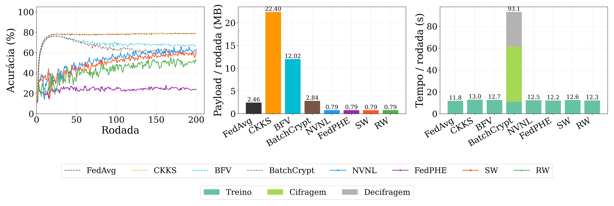

- **Acurácia por rodada (painel esquerdo).**
  - FedAvg e CKKS chegam a ≈ 78–79 %.
  - BFV e BatchCrypt atingem ≈ 77 % perto da rodada 30 e depois **degradam**, terminando em 67,7 % e 59,6 %. É o efeito acumulado da quantização em inteiros.
  - Com 10 % dos pacotes, a ordem é NVNL (63,3 %) > SW (61,6 %) > RW (52,1 %) ≫ FedPHE (24,2 %).
- **Upload por cliente por rodada (painel central).**
  - CKKS envia 22,4 MB, BFV 12,0 MB e BatchCrypt 2,84 MB.
  - As técnicas com packing enviam ≈ 0,79 MB. Esse valor é uma estimativa: `packs_sent × 2·N·8` bytes, usando o `packs_sent` truncado (6 packs em vez de 7).
  - O valor do FedAvg (2,46 MB) vem de `sys.getsizeof` sobre uma lista Python (≈ 9 B por parâmetro). O modelo em float32 tem 1,10 MB.
- **Tempo por rodada (painel direito).** Fica em ≈ 12 s para todas as soluções, dominado pelo treino, exceto BatchCrypt: 93 s, dos quais ≈ 81 s são cifragem e decifragem Paillier.

### 12.2 Acurácia final por técnica e porcentagem

<details>
<summary>Mapa de calor: acurácia final (5 modelos × 2 distribuições)</summary>

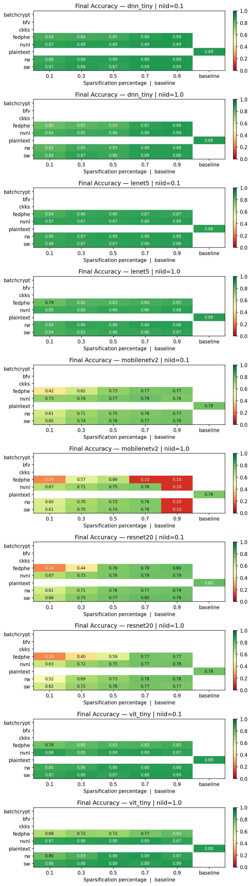
</details>

Cada painel corresponde a um modelo e uma distribuição. As linhas são soluções, as colunas são `p`, e a coluna `baseline` é o FedAvg. As linhas de CKKS, BFV e BatchCrypt ficam vazias nesta figura; os valores estão na tabela abaixo.

- **p = 0.1:** o NVNL tem a maior acurácia final em **9 das 10** combinações modelo × distribuição. A exceção é o `dnn_tiny` IID, em que o SW vence por 0,2 pp.
- **FedPHE:** é a técnica mais sensível à esparsificação. A p = 0.1, fica atrás do NVNL por 2,7 pp (`dnn_tiny`) a 43,7 pp (ResNet-20).
- **p ≥ 0.7:** NVNL, SW e RW ficam a no máximo 2,7 pp do FedAvg. O FedPHE ainda perde até 11,6 pp (ViT, não-IID).
- **Colapso:** o MobileNetV2 não-IID termina em 10 % (acaso) com p = 0.9 em todas as técnicas, e também com p = 0.7 no FedPHE.

**Baselines sem esparsificação.** A acurácia final aparece como IID / não-IID. "Cifrar (s)" é a média, por cliente e rodada, de pack + máscara + cifrar + serializar (`mean_he_overhead_s`, condição IID). O upload é o `payload_bytes` medido (real para TenSEAL e Paillier).

| Modelo | FedAvg | CKKS | BFV | BatchCrypt | Upload MB: CKKS · BFV · BatchCrypt | Cifrar (s): CKKS · BFV · BatchCrypt |
|---|---|---|---|---|---|---|
| dnn_tiny | .888 / .885 | .886 / .883 | .891 / .880 | .890 / .885 | 9,36 · 4,95 · 1,15 | 0,14 · 0,05 · 20,5 |
| lenet5 | .876 / .879 | .877 / .874 | .879 / .876 | .884 / .878 | 5,35 · 2,83 · 0,64 | 0,08 · 0,03 · 11,3 |
| resnet20 | .801 / .785 | .794 / .787 | .679 / .677 | .702 / .596 | 22,4 · 12,0 · 2,84 | 0,33 · 0,11 · 50,7 |
| mobilenetv2 | .781 / .764 | .769 / .761 | .767 / .749 | .774 / .762 | 58,8 · 31,1 · 7,44 | 0,97 · 0,31 · 137,8 |
| vit_tiny | .885 / .884 | .881 / .879 | .882 / .885 | .884 / .882 | 17,4 · 9,19 · 2,18 | 0,30 · 0,09 · 39,8 |

- **CKKS:** mantém a acurácia do FedAvg e custa ≈ 20× o modelo em float32 em upload.
- **BatchCrypt:** o upload fica próximo do tamanho do modelo, mas o tempo de cifragem é 2–3 ordens de grandeza maior.
- **BFV e BatchCrypt no ResNet-20:** chegam a ≈ 77–78 % perto da rodada 30 (`tables/15_bytes_maxacc.csv`) e depois degradam.

### 12.3 Bytes até a acurácia máxima (ResNet-20, não-IID, p = 0.1)

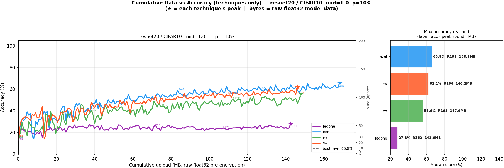

- **Eixos (painel esquerdo):** x = upload acumulado (MB em float32 antes da cifra, somado sobre os 9 clientes); y = acurácia. A estrela marca o pico de cada técnica.
- **Pico de cada técnica (painel direito):** NVNL 65,8 % (rodada 191, 168 MB), SW 62,1 % (146 MB), RW 55,6 % (148 MB) e FedPHE 27,8 % (143 MB).
- **Leitura:** as quatro técnicas enviam o mesmo número de packs por rodada. A diferença de acurácia vem **só de quais packs** são enviados.
- **Deduplicação:** depois dela, o custo do NVNL é igual ao do SW. As figuras antigas mostravam o NVNL com ≈ 2× mais MB por causa de reruns duplicados.

### 12.4 Onde o tempo é gasto

<details>
<summary>Decomposição do tempo por rodada (mediana), todas as técnicas com packing</summary>

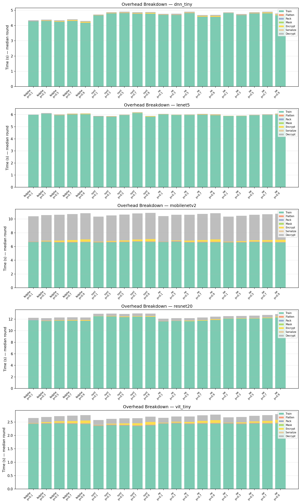
</details>

- **Treino:** domina em todos os modelos, de 2,4 s (ViT) a 12 s (ResNet-20) por rodada.
- **Operações de HE no cliente** (pack + máscara + cifrar + serializar): somam de 0,007 s a 0,38 s por rodada e crescem linearmente com `p`.
- **Decifragem (cinza):** é a maior fatia de HE, porque `decrypt_time_s` inclui desserializar, decifrar e reconstruir o modelo inteiro. No MobileNetV2 (176 packs) chega a ≈ 3,5–3,8 s de ≈ 10,5 s.

### 12.5 Cobertura do modelo

**Rodadas até cobrir o modelo inteiro (teórico, estudo 10).**

<details>
<summary>NVNL vs SW: rodadas até cobertura total</summary>

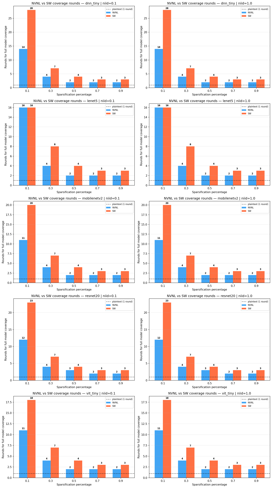
</details>

- Com `p` pequeno, o SW precisa de cerca de 2× as rodadas do NVNL, por causa da sobreposição de 50 % entre janelas.
- A figura usa o `packs_sent` registrado (truncado) e por isso superestima. No ResNet-20 a p = 0.1 ela mostra 12 / 23, enquanto o `k` real (7) dá 10 / 17 e o observado é 10 / 16 (`tables/24_full_coverage_convergence_all.csv`).

**Cobertura observada de packs únicos (NVNL, ResNet-20).**

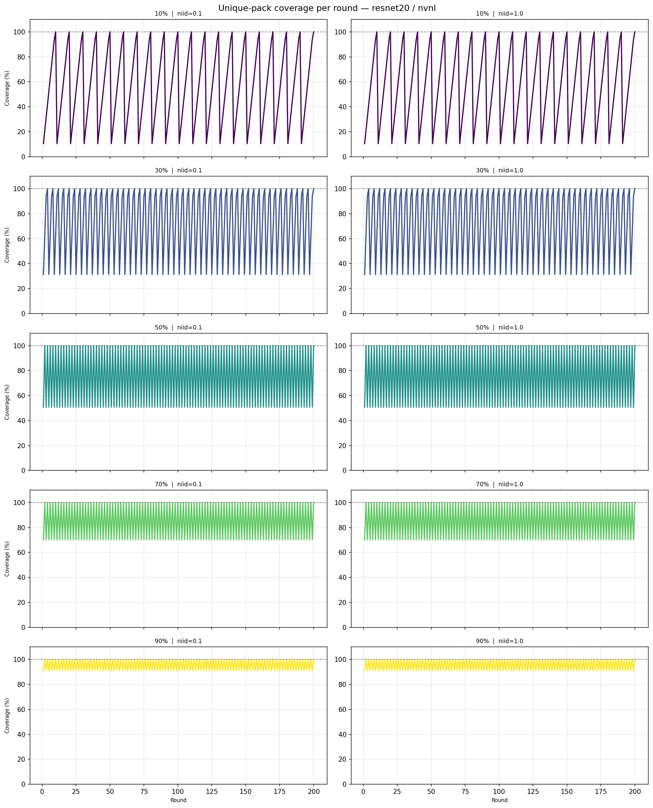

- Cada linha do grid é uma porcentagem e cada coluna uma distribuição.
- A curva sobe `k/n` por rodada e zera ao atingir 100 %, formando um dente de serra.
- A p = 0.1 o ciclo tem 10 rodadas (20 ciclos em 200 rodadas), exatamente `ceil(67/7)`.
- A curva é idêntica nas duas distribuições, porque a máscara não depende dos dados.

**Cobertura e acurácia do FedPHE (ResNet-20).**

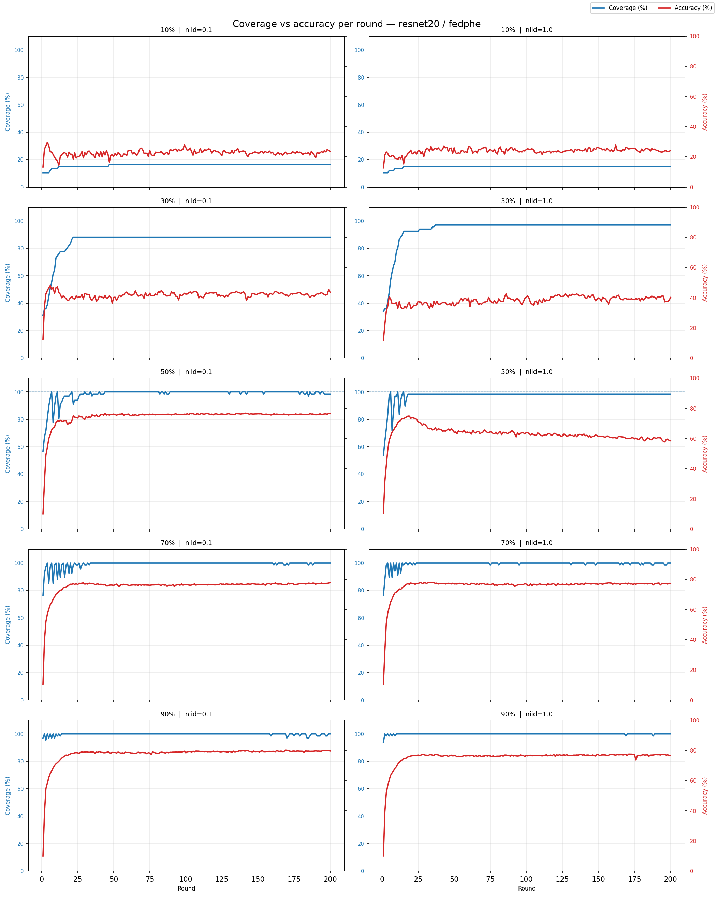

Azul = cobertura acumulada da união no servidor; vermelho = acurácia.

| p | Cobertura | Acurácia |
|---|---|---|
| 0.1 | trava em ≈ 15 % | ≈ 25 % |
| 0.3 | satura em 88–97 % | ≈ 40–45 % |
| ≥ 0.5 | chega a ≈ 100 % (o top-k dos 9 clientes difere o bastante) | ≈ nível do FedAvg |

A acurácia do FedPHE acompanha a cobertura. Packs que nunca são agregados continuam com o valor local de cada cliente.

**Frequência de envio de cada pack.**

| FedPHE (top-k) | NVNL (round-robin) |
|---|---|
| 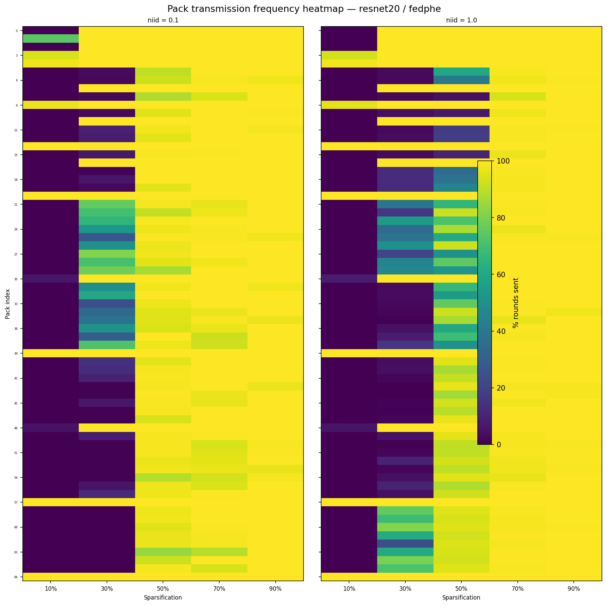 | 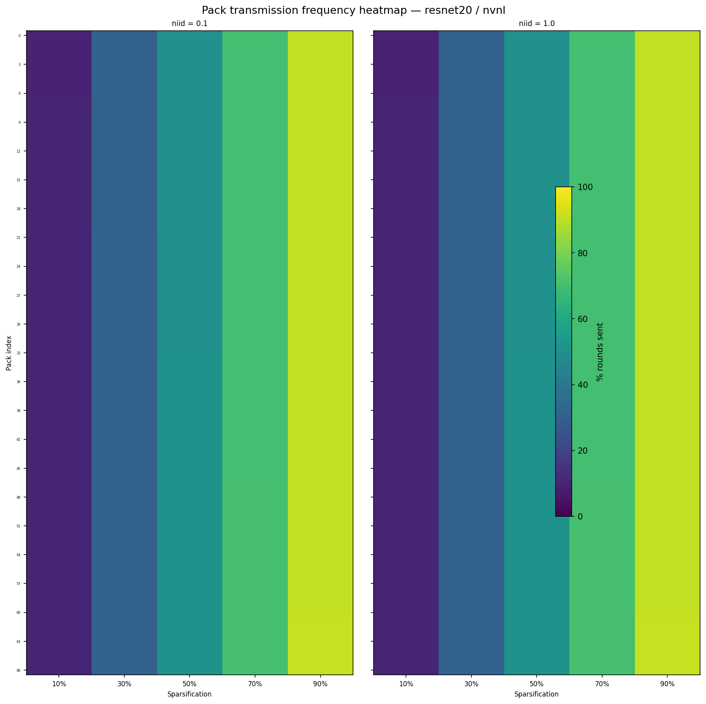 |

Eixos: y = índice do pack (0–66), x = porcentagem; a cor indica a % de rodadas em que o pack foi agregado.
- **FedPHE:** padrão bimodal. A p = 0.1, poucos packs vão em 100 % das rodadas e o resto nunca é enviado.
- **NVNL:** cada pack é enviado em exatamente `p` das rodadas.

**Inflação do downlink (estudo 26).**

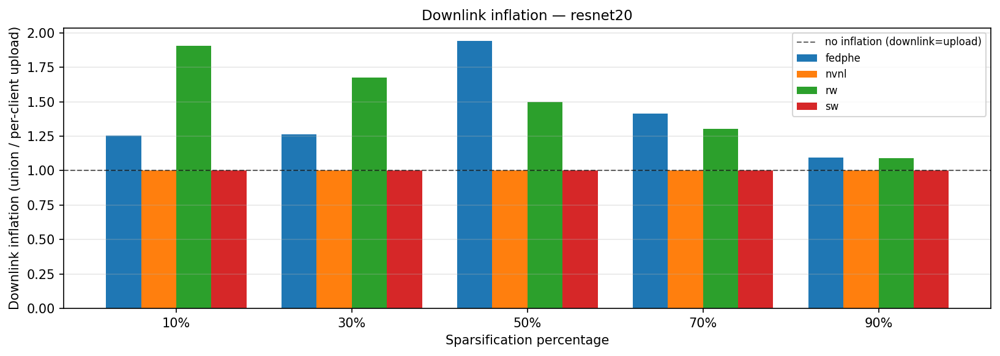

- **O que mede:** o servidor devolve a **união** dos packs recebidos, e a métrica é o tamanho dessa união dividido pelo que cada cliente enviou.
- **NVNL e SW:** 1,00, porque todos os clientes enviam os mesmos packs na mesma rodada.
- **RW:** vai de 1,91 (p = 0.1) a 1,09 (p = 0.9).
- **FedPHE:** 1,26 a p = 0.1 e 1,94 a p = 0.5.
- **Consequência:** RW e FedPHE baixam até ≈ 2× o que sobem.
- **RW e seeds:** com sorteios independentes, a união a p = 0.1 cobriria ≈ 63 % do modelo (inflação ≈ 6). O valor observado é 19,9 %, o que confirma que os clientes compartilham máscaras (ver [seção 15](#15-limitações-e-problemas-conhecidos)).

### 12.6 Efeito da heterogeneidade dos dados

<details>
<summary>Δ acurácia = acc(não-IID, α = 1) − acc(IID)</summary>

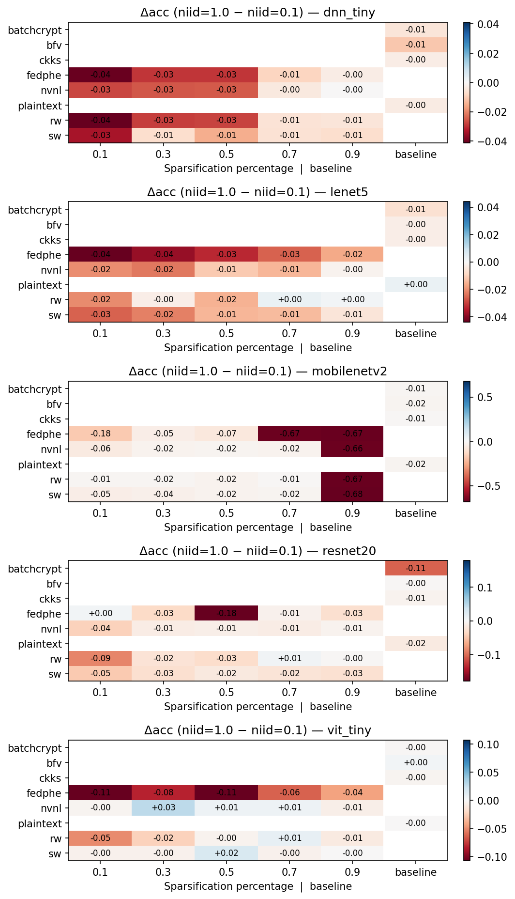
</details>

Valores negativos indicam que a heterogeneidade custa acurácia.
- **FedAvg e baselines HE:** perdem no máximo 2 pp, exceto o BatchCrypt no ResNet-20 (−11 pp).
- **FedPHE:** é o mais afetado (ViT: −11 pp a p = 0.1; ResNet-20: −18 pp a p = 0.5).
- **NVNL:** perde no máximo 4 pp e no ViT chega a ganhar.
- **MobileNetV2 a p = 0.9:** os −66 a −68 pp são o colapso descrito na [seção 15](#15-limitações-e-problemas-conhecidos), não um efeito da distribuição.

### 12.7 Participação parcial de clientes (`client_frac`, ResNet-20, 60 clientes, p = 0.1, não-IID)

| cf = 0.25 (15 clientes por rodada) | cf = 0.75 (45 clientes por rodada) |
|---|---|
| 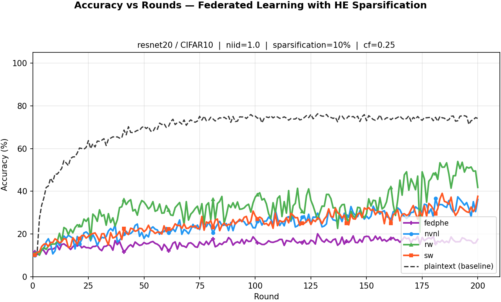 | 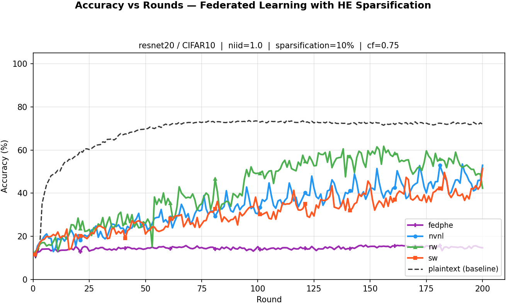 |

A tabela mostra a acurácia na última rodada, com uma run por configuração. Os valores foram calculados dos logs por fração, porque as figuras e tabelas 01–24 de `client_frac` misturam as três frações.

| Técnica | cf = 0.25 | cf = 0.5 | cf = 0.75 |
|---|---|---|---|
| FedAvg | 74,1 % | 73,9 % | 72,0 % |
| NVNL | 36,2 % | 44,7 % | 52,9 % |
| SW | 37,7 % | 46,5 % | 51,5 % |
| RW | 41,8 % | 62,5 % | 42,3 % |
| FedPHE | 17,6 % | 15,8 % | 14,7 % |

- **Distância do FedAvg:** com 60 clientes e p = 0.1, todas as técnicas ficam longe do FedAvg. Cada cliente tem ≈ 1/60 dos dados, e cada pack só é atualizado em uma de cada ≈ 10 rodadas.
- **NVNL e SW:** melhoram de forma monotônica com mais clientes por rodada.
- **RW:** chega ao maior valor entre as técnicas (62,5 % em cf = 0.5), mas oscila muito entre rodadas.
- **FedPHE:** fica abaixo de 18 % em todas as frações.
- **p = 0.5:** o RW chega a 73–77 %, NVNL e SW a 62–68 %, e o FedPHE melhora com `cf` (36 % → 70 % no não-IID).

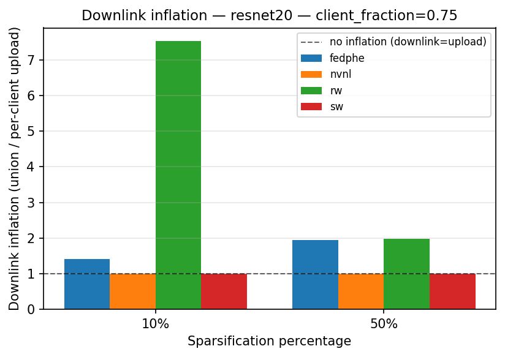

O ganho do RW aparece no **downlink**, porque com 60 clientes as máscaras divergem e a união cobre boa parte do modelo:
- **RW:** inflação de 6,4× a 8,2× a p = 0.1, crescendo com `cf`, e ≈ 2× a p = 0.5.
- **FedPHE:** de 1,15× a 1,41× a p = 0.1, e até 1,95× a p = 0.5.
- **NVNL e SW:** continuam em 1,00×.

Fonte: `studies/client_frac/tables/26_union_coverage_downlink_summary.csv`.

### 12.8 Variância entre seeds (`seed_experiment`)

O estudo `studies/general/29_seed_variance.py` junta a seed 42 (`sparsification_percentage`, com as células de `range_fix` substituindo as antigas) às seeds 43/44 (`seed_experiment_v2`). Para cada técnica com packing, em α = 1 e p ∈ {0.1, 0.7}, ele gera a média, o desvio e a variância da acurácia final, em barras e em curvas com faixa, e descarta as runs com NaN. A saída vai para `studies/seed_experiment_v2/`. Enquanto a v2 não roda, `--seed-dir logs/seed_experiment` gera uma prévia com os logs de agosto (ver `docs/seed_experiment.md`).

---

## 13. Testes

```bash
pytest tests/                          # tudo o que não exige container
pytest tests/test_server_utils.py      # um arquivo
bash tests/test_merge_resume.sh        # merge de resume em pastas sintéticas
bash tests/test_checkpoint_resume.sh   # checkpoint/resume (usa logs de test_ckks_backend)
make test-ckks                         # tests/test_ckks_install.py dentro dos containers
```

| Arquivo | Testes | Cobre |
|---|---|---|
| `test_check_status.py` | 44 | parser de scripts, enumeração e classificação do `check_status.py` |
| `test_server_utils.py` | 15 | agregação CKKS real (TenSEAL); `[30,60,30]` com escala 2⁶⁰ é `xfail` |
| `test_model_reconstruction.py` | 12 | flatten, pack e reshape ida e volta |
| `test_magg_renorm.py` | 9 | `MAGG_RENORM` vs FedAvg de referência |
| `test_load_data_dedup.py` | 9 | deduplicação de reruns e fragmentos de resume |
| `test_ckks_install.py` | 6 | instalação do `ckks_project` (dentro do container) |

---

## 14. Documentação auxiliar

| Arquivo | Conteúdo |
|---|---|
| `docs/log_schema.md` | Esquema dos CSVs, compressão dos snapshots, escopo de `decrypt_time_s` (layout antigo) |
| `docs/analysis_studies.md` | Detalhes dos estudos 10–21 e da API do `load_data.py` |
| `docs/fedphe-audit.md` | Especificação para auditar a agregação segura do FedPHE |
| `docs/cap5_tabelas_auditoria.md` | Auditoria das tabelas do capítulo 5 (2026-07-30) |
| `docs/ckks_serialization_port.md` | Plano de portar a serialização do `CKKSContext` para o `ckks_project` |
| `docs/plano_pesquisa.md` | Prompt do plano de pesquisa (jun.–ago./2026) |
| `CKKS_PARAMS.md` | Como escolher `SIMPLIFY_N/BITS/SCALE_BITS` e sinais de overflow |
| `DIVISOR_AUDIT.md` | Auditoria do divisor da média com upload mascarado (origem do `MAGG_RENORM`) |
| `HARDENING.md` | Verificações antes da varredura final do NVNL |
| `SLURM.md` | Partições do cluster e fatores de velocidade |
| `experiments/ESTIMATION_METHODOLOGY.md` | Modelo de estimativa de tempo |

---

## 15. Limitações e problemas conhecidos

Os pontos abaixo foram verificados no código e nos logs. Nenhum deles foi corrigido neste repositório.

1. **Rótulo `NIID` invertido nas runs antes de 2026-08-11.**
   - O que acontece: nas famílias `sparsification_percentage`, `client_frac` e `stress_test_client`, a pasta `niid0.1` usa `IidPartitioner`.
   - Por quê: `niid = (NIID == 1)`, código hoje comentado em `client/client.py:407`.
   - Consequências: (a) nessas famílias, `niid0.1` tende a ter acurácia maior que `niid1`; (b) com `niid0.1`, as seeds 43/44 do `seed_experiment` (Dirichlet α = 0.1 de fato) não são comparáveis à seed 42; (c) as tabelas do estudo 24 e as da dissertação chamam `niid0.1` de "não-IID".
2. **O RW nunca atualiza os pesos dos pacotes.**
   - Em `client/literature/rw.py:165`, `np.array(weights_packs)` cria uma cópia. A penalidade e o reforço caem nela, e `self.weights_packs` fica sempre em 1.
   - O RW implementado é, portanto, um **sorteio uniforme de k packs por rodada**.
   - Como todos os clientes semeiam o NumPy com o mesmo `SEED`, vários clientes sorteiam as mesmas máscaras.
3. **`payload_bytes` não mede a mesma coisa em todas as soluções.** O valor é `Σ sys.getsizeof(pack serializado)`.
   - No `ckks_python_simplify`, mede só o objeto `list` do Python (≈ 72 B por pack).
   - No plaintext, mede ≈ 8 B por parâmetro.
   - No TenSEAL, é o tamanho real do ciphertext.
   - Por isso, os estudos 04 e 08 e a coluna `mean_payload_mb` do `summary.csv` não servem para comparar técnicas com packing. Os estudos 11, 12, 15 e 27 estimam bytes a partir de `packs_sent × pack_size`.
4. **Os pesos em claro também trafegam.** `HEClient.fit` sempre devolve `self.model.get_weights()` ao Flower (`client/client.py:331`), e o payload cifrado vai separado em `metrics['he']`. O servidor ignora a cópia em claro nos caminhos HE, mas ela é transmitida e não entra em `payload_bytes`.
5. **`packs_sent` é truncado.** O log registra `int(n·p)`, mas as máscaras usam `ceil(n·p)`. Exemplo: 67 packs a p = 0.9 aparecem como 60 no log, mas 61 são enviados.
6. **A coluna `client_fraction` do `train.csv` vale sempre 1.0.** A variável `CLIENT_FRACTION` só é passada ao servidor. A fonte correta é o token `cf<f>` no nome da pasta.
7. **Os estudos 01–24 de `client_frac` misturam as três frações de clientes.** Só os estudos 25, 26 e os `*_pt` separam por `cf`.
8. **Colapso numérico.** O MobileNetV2 com `niid1` a p = 0.9 termina com acurácia 0.100 (chance) em várias técnicas, depois de chegar a ≈ 0.77.
9. **Ferramentas quebradas ou desatualizadas:**
    - os alvos `make run` e `make graph`;
    - os runners `start_all*.sh` antigos;
    - `docs/log_schema.md` (layout antigo);
    - `docs/analysis_studies.md` (cita o caminho antigo dos scripts);
    - `TECHNIQUE`, que não é usado.

---

## 16. Referências, agradecimentos e licença

Este trabalho parte do artigo:

**"Exploring Communication Efficient Methods for Homomorphic Encryption Federated Learning"**
Yuri Dimitre D. Faria, Allan M. de Souza, Instituto de Computação, Universidade Estadual de Campinas (Unicamp).

Agradecimentos aos projetos que serviram de base:

- [FedPHE](https://github.com/lunan0320/FedPHE): *Efficient and Straggler-Resistant Homomorphic Encryption for Heterogeneous Federated Learning*.
- [BatchCrypt](https://github.com/marcoszh/BatchCrypt): *BatchCrypt: Efficient Homomorphic Encryption for Cross-Silo Federated Learning*.
- [FLASHE](https://github.com/SamuelGong/FLASHE): técnicas de esparsificação de pacotes.

Licença MIT: veja `LICENSE`.
